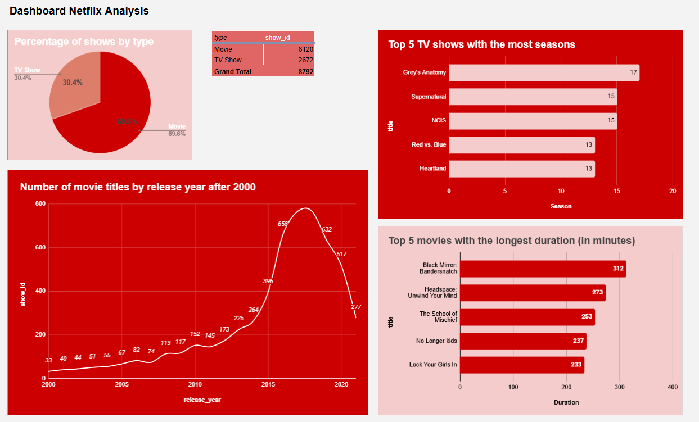

# Netflix Data Analysis Dashboard

## 📝 Project Overview
This project presents a comprehensive analysis of Netflix’s content catalog (films and TV series) to understand the distribution of content types, annual production trends, and characteristics such as duration and number of seasons. This interactive dashboard is designed to provide strategic insights for decision-makers in the digital streaming industry.

---
## Tools & Technologies
- Google Spreadsheets https://docs.google.com/spreadsheets/d/1hqap2cAMxVpLrfGMvwqMryRTrhISbCMT8Gzm6fk5-5c/edit?usp=sharing
- Data Cleaning
- Pivot Table
- PivotCharts
- Data Visualization
- Interactive Dashboard

--
## Dashboard Preview

## 🔍 Key Insights 
- **Movie** content dominates the platform, accounting for **69.6% (6,120 titles)**, while **TV Shows** make up **30.4% (2,672 titles)** of the total 8,792 titles.
- The number of film releases has shown consistent growth since 2000, reaching a peak in **2018 with 766 titles**, before subsequently experiencing an adjustment—or a downward trend—in the following years.
- The list of the top 5 TV shows with the most seasons is dominated by popular, long-running series such as **Grey's Anatomy** (17 seasons), **Supernatural** (15 seasons), and **NCIS** (15 seasons). Most of these series are licensed from traditional TV networks, indicating that Netflix leverages long-running shows to maintain the retention of its loyal audience..
- The chart of the top 5 longest movies reveals that the list is dominated by special or interactive formats—such as **Black Mirror: Bandersnatch**, which has a runtime of 312 minutes (owing to its interactive nature and multiple branching storylines)—as well as specialized documentaries or miniseries, like **Headspace: Unwind Your Mind** (273 minutes).
---

## 💡 Strategic Recommendations
1. Given that the share of TV shows remains significantly lower **30.4%**, it is recommended that Netflix increase its investment in the production of original series—whether as limited series or subsequent seasons. Series have proven to be the primary drivers of user engagement and long-term subscriptions (customer retention) compared to standalone films.
2. Management should analyze whether the decline in the number of film releases since 2018 was intentional—aimed at prioritizing high quality—or the result of production constraints. If this decline has negatively impacted user satisfaction, the production strategy should be revitalized by engaging a broader range of independent and global creators.
3. The success of longer-form content, such as **Black Mirror: Bandersnatch**, demonstrates that audiences value immersive and unconventional viewing experiences. Netflix could expand its experimentation with interactive content ("choose-your-own-adventure" style), in-depth thematic documentaries, or hybrid entertainment formats.
   
